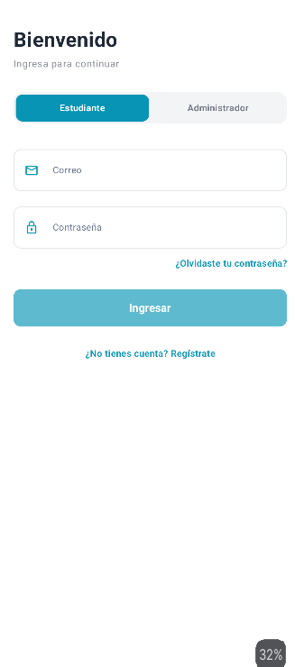
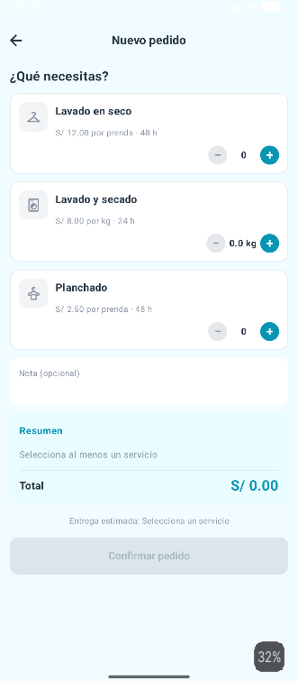
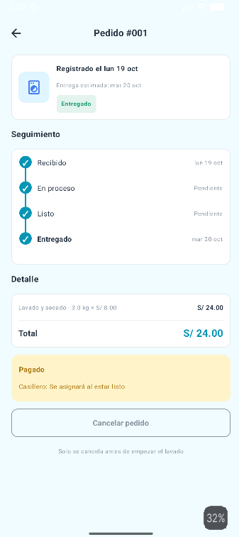
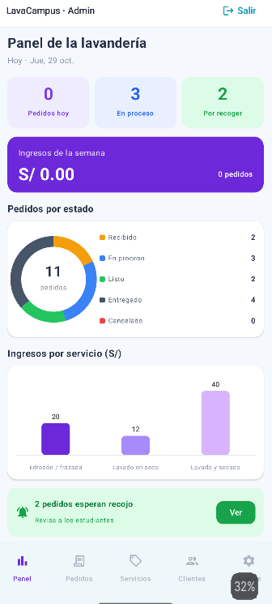
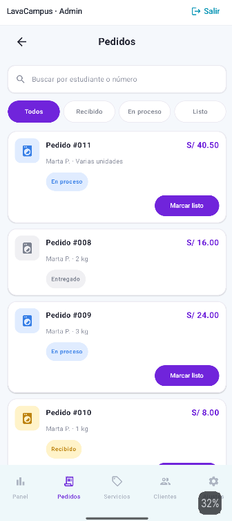
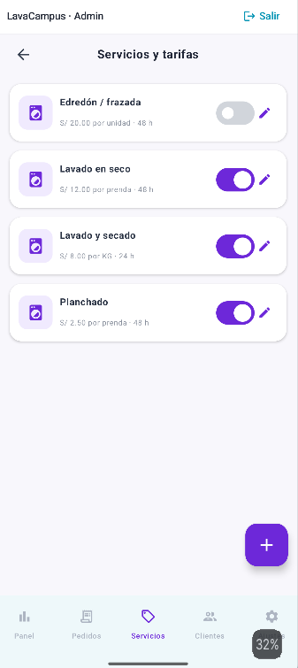

# LavaCampus

## 1. Descripción del proyecto

LavaCampus es una aplicación móvil desarrollada en Android Studio
con Kotlin y Jetpack Compose, orientada a la gestión del servicio
de lavandería para estudiantes de una institución educativa.

La aplicación permite a los estudiantes registrar pedidos,
consultar sus estados, revisar el historial de servicios y
administrar sus preferencias.

Por otro lado, el administrador puede gestionar los pedidos,
actualizar sus estados, asignar casilleros, administrar los
servicios disponibles y consultar información de los clientes.

## 2. Tecnologías utilizadas

- Kotlin
- Jetpack Compose
- Android Studio
- Room Database
- DataStore
- Arquitectura MVVM
- Material Design 3
- Git y GitHub

## 3. Funcionalidades principales

### Estudiante

- Inicio de sesión.
- Registro de pedidos de lavandería.
- Selección de servicios y cantidades.
- Cálculo automático del costo total.
- Cálculo de fecha estimada de entrega.
- Consulta del historial de pedidos.
- Seguimiento del estado de los pedidos.
- Cancelación de pedidos cuando corresponde.
- Consulta de información del perfil.
- Configuración del modo oscuro y notificaciones.

### Administrador

- Inicio de sesión como administrador.
- Consulta y gestión de pedidos.
- Actualización de estados.
- Asignación de casilleros.
- Registro de pagos.
- Gestión de servicios.
- Consulta de clientes.
- Consulta de estadísticas e ingresos.
- Configuración de preferencias.
- Activación o desactivación de la recepción de pedidos.

## 4. Arquitectura del proyecto

La aplicación utiliza el patrón MVVM
(Model - View - ViewModel), que permite separar
la interfaz gráfica de la lógica y del acceso a los datos.

### Model

Representa la información de la aplicación,
como usuarios, servicios, pedidos y detalles de pedidos.

### View

Contiene las pantallas desarrolladas con Jetpack Compose.

### ViewModel

Gestiona los datos y las operaciones necesarias
para cada pantalla.

### Repository

Se encarga de comunicar los ViewModels con
la base de datos local.

### Room

Permite almacenar los datos de manera persistente
en el dispositivo.

### DataStore

Almacena preferencias como el modo oscuro,
las notificaciones y la sesión del usuario.

## 5. Diagrama MVVM

```text
              USUARIO
                 |
                 v
        +------------------+
        |       VIEW       |
        |  Jetpack Compose |
        +------------------+
                 |
                 v
        +------------------+
        |    VIEWMODEL     |
        | Lógica de la UI  |
        +------------------+
                 |
                 v
        +------------------+
        |    REPOSITORY    |
        | Acceso a datos   |
        +------------------+
                 |
                 v
        +------------------+
        |      ROOM        |
        |  Base de datos   |
        +------------------+

        DataStore
        |
        +--> Sesión y preferencias
```

## 6. Estructura de paquetes

```text
com.alvarez.lavacampus
|
+-- data
|   +-- local
|   |   +-- dao
|   +-- model
|   +-- prefs
|   +-- repository
|
+-- ui
|   +-- administrador
|   +-- estudiante
|   +-- theme
|
+-- viewmodel
|
+-- MainActivity.kt
```

Esta estructura resume la organización principal
del proyecto.

## 7. Reglas de negocio

La aplicación implementa diferentes validaciones:

- No permite iniciar sesión con credenciales incorrectas.
- No permite registrar pedidos sin seleccionar servicios.
- Calcula automáticamente el precio de los pedidos.
- Calcula la fecha de entrega sin contar los domingos.
- Permite un máximo de tres pedidos activos por estudiante.
- Impide cancelar pedidos que ya están en proceso.
- Requiere asignar un casillero antes de marcar un pedido como LISTO.
- No permite seleccionar casilleros ocupados.
- Impide entregar pedidos pendientes de pago.
- Protege los servicios que ya fueron utilizados en pedidos.
- Conserva los datos al cerrar y volver a abrir la aplicación.

## 8. Pruebas de aceptación

Se realizaron pruebas de aceptación para comprobar
las funcionalidades principales de LavaCampus.

| N.º | Prueba | Resultado |
|---|---|---|
| 1 | Inicio de sesión con contraseña incorrecta | Aprobado |
| 2 | Registro de pedido sin servicios | Aprobado |
| 3 | Cálculo de pedido de S/ 40.50 | Aprobado |
| 4 | Límite de tres pedidos activos | Aprobado |
| 5 | Cancelación de pedido EN_PROCESO | Aprobado |
| 6 | Pedido LISTO sin casillero | Aprobado |
| 7 | Selección de casillero ocupado | Aprobado |
| 8 | Entrega de pedido sin pago | Aprobado |
| 9 | Actualización del seguimiento del pedido | Aprobado |
| 10 | Cálculo de ingresos semanales | Aprobado |
| 11 | Eliminación de servicio utilizado | Aprobado |
| 12 | Persistencia de datos y preferencias | Aprobado |

## 9. Capturas de pantalla

### Estudiante

**Inicio del estudiante**



**Registro de nuevo pedido**



**Seguimiento de pedidos**



### Administrador

**Panel principal**



**Gestión de pedidos**



**Gestión de servicios**



## 10. Conclusiones

El desarrollo de LavaCampus permitió aplicar
la arquitectura MVVM para organizar mejor
la lógica de negocio y las pantallas de la aplicación.

La implementación de Room y DataStore permitió
conservar los pedidos, usuarios y preferencias
sin depender de una conexión permanente a Internet.

Finalmente, las validaciones implementadas
permitieron mejorar el control de los pedidos,
evitando registros incorrectos y operaciones
que no cumplen con las reglas del servicio.

## 11. Autor

Proyecto académico desarrollado para el curso
de Programación en Móviles.

Carrera: Diseño y Desarrollo de Software.

Institución: TECSUP.