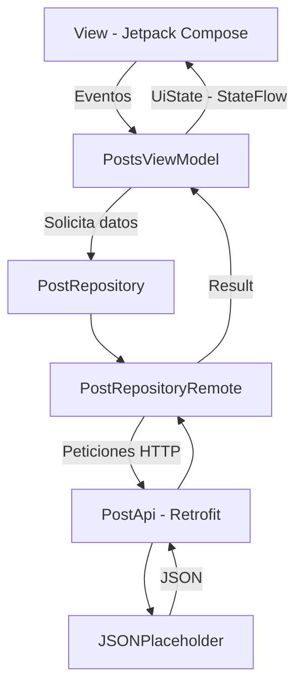
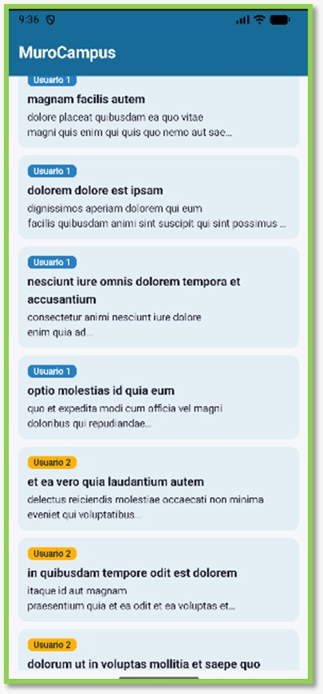
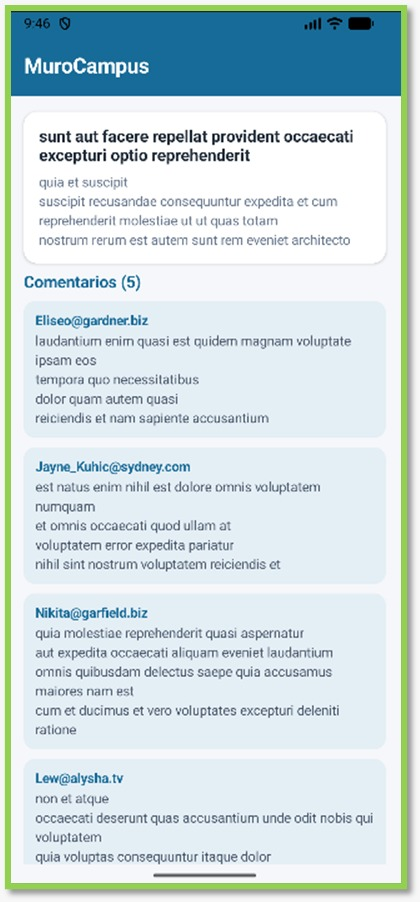
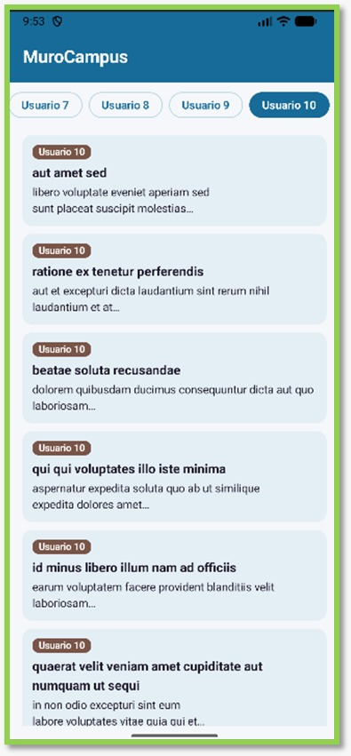
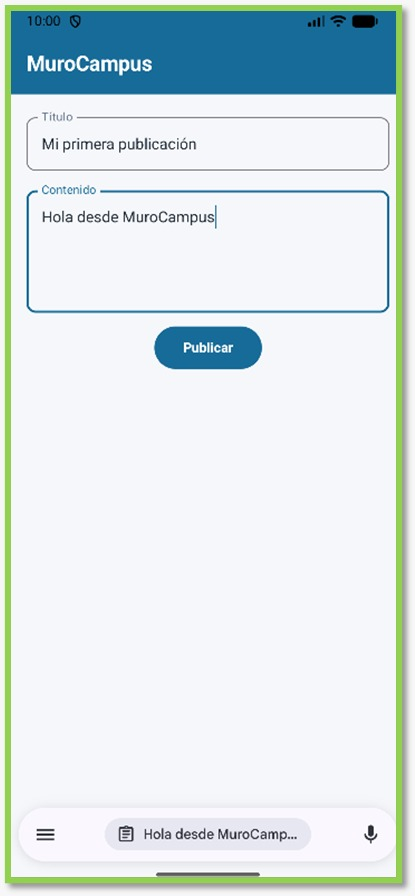
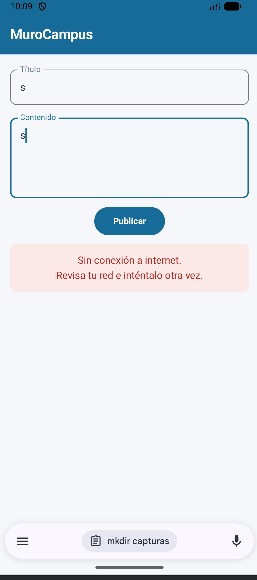

# MuroCampus

## Descripción

MuroCampus es una aplicación móvil desarrollada en Kotlin
con Jetpack Compose que consume el servicio REST
JSONPlaceholder mediante Retrofit.

Laboratorio 09 - Programación en Móviles

## Funcionalidades

- Listado de publicaciones.
- Detalle de publicaciones y comentarios.
- Filtrado por usuario.
- Creación de publicaciones.
- Manejo de errores de conexión.
- Reintento de peticiones.

## Tecnologías utilizadas

- Kotlin
- Jetpack Compose
- Retrofit
- OkHttp
- Kotlinx Serialization
- Coroutines
- StateFlow
- Arquitectura MVVM + Repository
- Git y GitHub

## Estructura del proyecto

```text
com.alvarez.murocampus/
├── MainActivity.kt
├── model/
│   └── Modelos.kt
├── data/
│   ├── MensajesError.kt
│   ├── PostRepository.kt
│   └── remote/
│       ├── PostApi.kt
│       └── RetrofitClient.kt
├── viewmodel/
│   ├── UiState.kt
│   ├── PostsViewModel.kt
│   └── PostsViewModelFactory.kt
└── ui/
    ├── Componentes.kt
    ├── PantallaLista.kt
    ├── PantallaDetalle.kt
    ├── PantallaCrear.kt
    └── theme/
        ├── Color.kt
        ├── Theme.kt
        └── Type.kt
```

## Arquitectura MVVM + Repository



La pantalla se encarga de mostrar la información y recibir
las acciones del usuario. El ViewModel administra los
estados y solicita los datos al Repository.

El Repository realiza las operaciones mediante PostApi
y devuelve un Result de éxito o error.

## Endpoints utilizados

| Método | Ruta | Función |
|---|---|---|
| GET | posts | Listar publicaciones |
| GET | posts/{id} | Obtener detalle |
| GET | posts/{id}/comments | Obtener comentarios |
| GET | posts?userId=2 | Filtrar por usuario |
| POST | posts | Crear publicación |

## Capturas de la aplicación

### Lista de publicaciones



### Detalle y comentarios



### Filtro por usuario



### Crear publicación



### Error de conexión



## Para pensar

### 1. Diferencia entre GET y POST. Uso de @Body y @Query

[Explicar cómo se consultan y envían los datos.]

### 2. ¿Por qué se utiliza posts y no /posts?

[Explicar cómo Retrofit combina la ruta con la URL base.]

### 3. ¿Por qué el Repository devuelve Result?

[Explicar el manejo de éxito, errores y responsabilidades.]

### 4. Permiso INTERNET e ignoreUnknownKeys

[Explicar qué ocurre cuando falta cada configuración.]

### 5. ¿Por qué se utiliza when sobre UiState?

[Explicar los tres estados y cómo se muestran.]

### 6. ¿Qué cambiaría con un servicio real?

[Explicar la persistencia de publicaciones en el servidor.]

## Conclusiones

- Retrofit permite consumir servicios REST desde Android.
- MVVM permite separar la interfaz de la lógica de datos.
- El manejo de estados permite responder a errores de red
  sin cerrar inesperadamente la aplicación.
