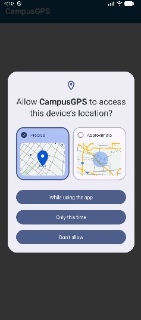
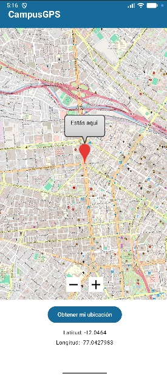
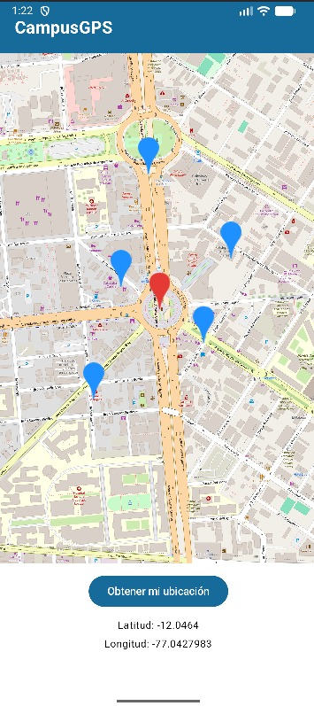
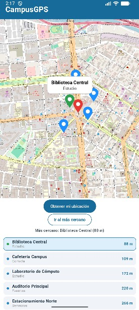
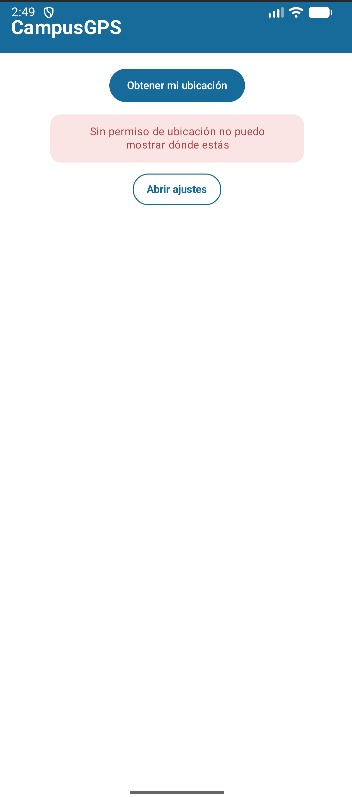

# CampusGPS

## Descripción

CampusGPS es una aplicación Android desarrollada con Kotlin y Jetpack Compose. Permite obtener la ubicación del usuario, mostrar un mapa y consultar cinco lugares del campus.

La aplicación calcula la distancia desde nuestra ubicación hasta cada lugar, ordena la lista del más cercano al más lejano y permite seleccionar un lugar para mover la cámara del mapa.

También identifica el lugar más cercano con un marcador verde y muestra mensajes cuando hay problemas con los permisos o el GPS.

## Tecnologías utilizadas

- Kotlin
- Jetpack Compose y Material 3
- Arquitectura MVVM
- Repository
- OpenStreetMap con osmdroid
- Google Play Services Location
- StateFlow y corrutinas
- Android Studio y GitHub

## Funcionalidades

1. Solicitar permiso de ubicación al usuario.
2. Obtener la ubicación actual y mostrarla con un marcador rojo.
3. Mostrar cinco lugares del campus mediante marcadores.
4. Calcular las distancias en metros o kilómetros.
5. Ordenar los lugares por distancia.
6. Seleccionar un lugar desde la lista y mover la cámara.
7. Identificar el lugar más cercano con un marcador verde.
8. Mostrar mensajes de error cuando se deniega el permiso, se apaga el GPS o faltan los servicios de Google.

## Estructura del proyecto

```text
com.alvarez.campusgps
│
├── data
│   ├── LugaresRepository.kt
│   ├── LugaresRepositoryLocal.kt
│   ├── UbicacionRepository.kt
│   └── UbicacionRepositoryGoogle.kt
│
├── model
│   └── Modelos.kt
│
├── ui
│   ├── ListaLugares.kt
│   ├── MapaUbicacion.kt
│   ├── MensajeError.kt
│   ├── PantallaMapa.kt
│   └── theme
│
├── util
│   ├── Distancia.kt
│   └── Formato.kt
│
├── viewmodel
│   ├── CampusViewModelFactory.kt
│   └── MapaViewmodel.kt
│
└── MainActivity.kt
```

## Arquitectura MVVM + Repository

El proyecto está organizado por capas para separar la interfaz, la lógica y el acceso a los datos.

```text
             USUARIO
                |
                v
        VIEW (Jetpack Compose)
          PantallaMapa.kt
          MapaUbicacion.kt
          ListaLugares.kt
          MensajeError.kt
                |
                v
             VIEWMODEL
          MapaViewModel
                |
                v
           REPOSITORY
       UbicacionRepository
         LugaresRepository
                |
                v
              DATOS
     Google Play Services Location
         Lugares locales
```

**View:** muestra el mapa, los botones, las tarjetas y los mensajes de error.

**ViewModel:** administra los estados de la pantalla, calcula y ordena las distancias, identifica el lugar más cercano y controla la selección.

**Repository:** obtiene la ubicación del dispositivo y proporciona los lugares del campus.

**Model:** contiene las clases de datos y los estados utilizados por la aplicación.

## Capturas de funcionamiento

### 1. Permiso de ubicación

Al pulsar el botón por primera vez, Android solicita autorización para acceder a la ubicación.



### 2. Ubicación actual

Después de conceder el permiso, la aplicación obtiene la ubicación y la representa en el mapa.



### 3. Marcadores del campus

Se muestran los cinco lugares. El marcador verde identifica el más cercano, los azules representan los demás lugares y el rojo indica nuestra ubicación.



### 4. Lista ordenada por distancia

Los lugares aparecen ordenados desde el más cercano hasta el más lejano. Al seleccionar una tarjeta, el mapa se mueve hacia ese lugar.



### 5. Manejo de errores

Cuando se deniega el permiso o no se puede obtener la ubicación, la aplicación muestra un mensaje y una acción para solucionar el problema.



## Respuestas: Para pensar

### 1. ¿Por qué FusedLocationProviderClient está dentro del Repository y no en el ViewModel?

Porque el Repository se encarga de obtener los datos. En este caso, utiliza FusedLocationProviderClient para consultar la ubicación del dispositivo.

El ViewModel solo recibe el resultado y actualiza el estado de la pantalla. Así mantenemos separadas las responsabilidades y el código es más fácil de mantener.

### 2. ¿Qué diferencia hay entre el permiso de ubicación y la clave de API de Maps? ¿Qué pasa si falta cada uno?

El permiso de ubicación es la autorización que da el usuario para que la aplicación pueda acceder a su posición.

La clave de API de Maps sirve para autorizar el uso de los servicios de Google Maps.

Si el usuario no concede el permiso, no podemos obtener su ubicación. Si falta una clave válida en una aplicación que utiliza Google Maps, el mapa puede no cargarse correctamente.

En nuestro proyecto utilizamos OpenStreetMap con osmdroid para mostrar el mapa, por lo que no dependemos de una clave de Google Maps para visualizarlo.

### 3. ¿Por qué la clave va en local.properties y no en el código? ¿Qué harías si se subiera a GitHub por error?

Porque una clave privada no debe quedar escrita directamente en el código ni publicarse en GitHub.

El archivo local.properties permite mantener configuraciones locales fuera del repositorio.

Si una clave se subiera por error, tendría que revocarla o restringirla, generar una nueva y revisar el historial del repositorio para evitar que siga expuesta.

### 4. ¿Dónde calculas la distancia y por qué no en el Composable?

La distancia se calcula en `util/Distancia.kt`, mediante la función `distanciaMetros()`, que utiliza `Location.distanceBetween()`.

El ViewModel llama a esa función y ordena los lugares por distancia.

No realizamos ese cálculo en el Composable porque la interfaz debe encargarse principalmente de mostrar los datos, no de procesarlos.

### 5. ¿Qué pasa con tu app si el usuario niega el permiso dos veces? ¿Cómo lo manejas?

La aplicación no se cierra. Si el permiso es denegado, mostramos un mensaje indicando que no podemos obtener la ubicación.

También aparece el botón **Abrir ajustes**, que permite entrar a la configuración de CampusGPS para conceder el permiso manualmente.

De esta manera, el usuario puede solucionar el problema sin que la aplicación falle.

## Conclusiones

1. Aprendí a obtener la ubicación del dispositivo y mostrarla en un mapa usando Kotlin y Jetpack Compose.

2. La arquitectura MVVM con Repository me permitió separar la interfaz de la lógica y organizar mejor el proyecto.

3. Implementar el cálculo de distancias, la selección de lugares y el manejo de errores ayudó a que la aplicación sea más completa y fácil de utilizar.