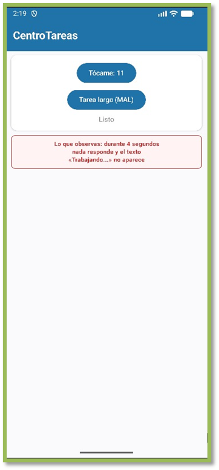
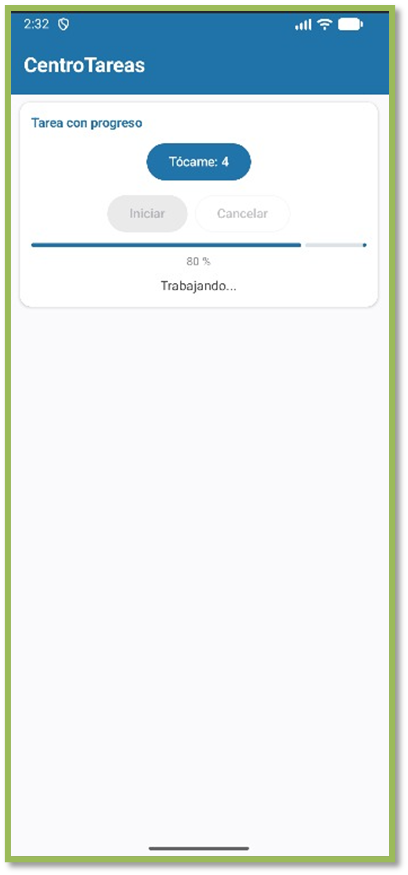
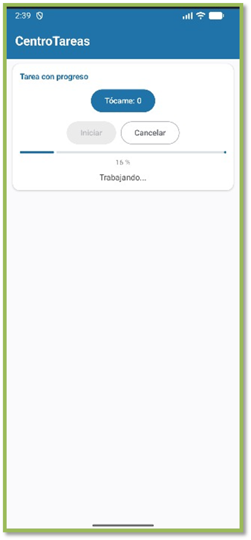
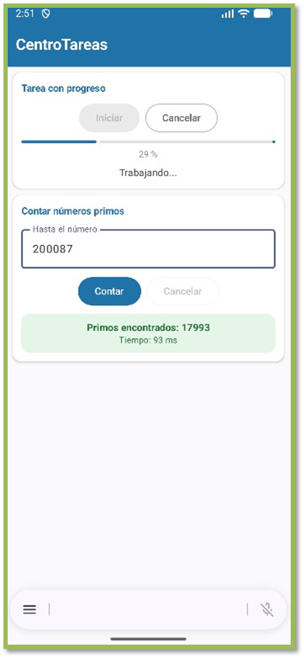
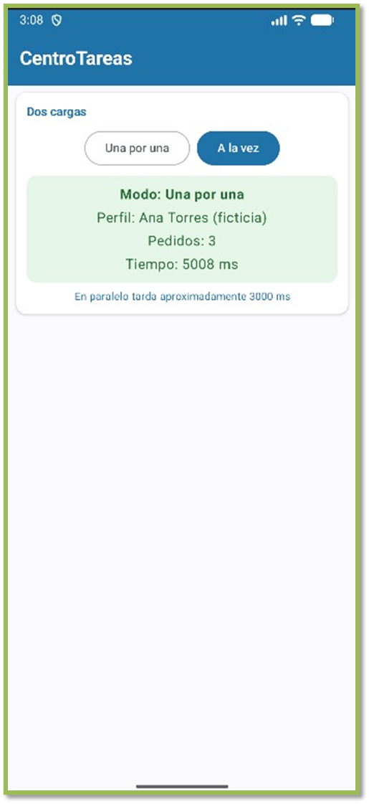

# CentroTareasTec

## 1. Descripción del proyecto

CentroTareasTec es una aplicación Android desarrollada en Kotlin y Jetpack Compose para practicar el uso de hilos y corrutinas.

Durante el laboratorio aprendimos a ejecutar tareas que requieren tiempo o procesamiento sin bloquear la interfaz de usuario. También trabajamos con barras de progreso, cancelación de tareas, cálculos matemáticos, cargas secuenciales y paralelas, y manejo de errores.

El proyecto se desarrolló por etapas, realizando pruebas y commits en GitHub para guardar cada avance.

## 2. Tecnologías utilizadas

- Kotlin
- Android Studio
- Jetpack Compose
- Corrutinas de Kotlin
- StateFlow
- ViewModel
- Git y GitHub

## 3. Estructura del proyecto

La aplicación está organizada de la siguiente manera:

```text
CentroTareasTec/
├── app/
│   └── src/
│       └── main/
│           └── java/
│               └── com/
│                   └── alvarez/
│                       └── centrotareas/
│                           ├── data/
│                           │   ├── TareasRepository.kt
│                           │   └── TareasRepositoryLocal.kt
│                           ├── model/
│                           │   └── Estados.kt
│                           ├── ui/
│                           │   └── PantallaTareas.kt
│                           ├── viewmodel/
│                           │   └── TareasViewModel.kt
│                           └── MainActivity.kt
└── README.md
```

## 4. Arquitectura MVVM

En el proyecto utilizamos la arquitectura MVVM para separar la interfaz de usuario de la lógica de la aplicación.

```text
       VISTA (UI)
    PantallaTareas.kt
           |
           v
       VIEWMODEL
    TareasViewModel.kt
           |
           v
       REPOSITORY
  TareasRepositoryLocal.kt
```

### Vista

El archivo `PantallaTareas.kt` contiene la interfaz creada con Jetpack Compose.

Se encarga de mostrar los botones, barras de progreso, resultados y mensajes de error.

### ViewModel

El archivo `TareasViewModel.kt` controla los estados de la aplicación y ejecuta las tareas mediante corrutinas.

Utilizamos `viewModelScope` para que las tareas estén relacionadas con el ciclo de vida del ViewModel.

### Repository

El archivo `TareasRepositoryLocal.kt` contiene las operaciones que simulan la carga de datos y realizan el cálculo de números primos.

Esta separación permite mantener el código más ordenado.

## 5. Desarrollo del laboratorio

### Paso 1. Congelamiento de la interfaz

Primero realizamos una tarea utilizando `Thread.sleep()` en el hilo principal.

Observamos que, mientras se ejecutaba, la aplicación dejaba de responder temporalmente.

El contador del botón tampoco podía actualizarse durante ese tiempo.

Esto permitió comprender por qué no debemos realizar tareas largas en el hilo principal.

### Paso 2. Uso de corrutinas

Después reemplazamos el bloqueo del hilo principal por una corrutina.

Utilizamos `viewModelScope.launch` y `withContext(Dispatchers.Default)` para ejecutar el trabajo sin congelar la pantalla.

También revisamos Logcat con el filtro `HILO` para observar en qué hilos se ejecutaban las operaciones.

### Paso 3. Barra de progreso

Implementamos una barra que avanzaba desde 0 % hasta 100 %.

Utilizamos `StateFlow` para actualizar el progreso y mostrar los cambios en la interfaz.

De esta manera, el usuario podía observar el avance de la tarea.

### Paso 4. Cancelación de tareas

Agregamos la posibilidad de cancelar una tarea mediante `Job`.

Al presionar el botón Cancelar, la operación se detenía y se mostraba el estado correspondiente.

También verificamos que no se iniciaran dos tareas iguales al mismo tiempo.

### Paso 5. Contar números primos

Implementamos una función que cuenta cuántos números primos existen hasta un número ingresado por el usuario.

El cálculo se realiza con `Dispatchers.Default` porque requiere procesamiento.

También utilizamos `ensureActive()` para comprobar si la corrutina fue cancelada.

Por ejemplo, al ingresar 1000, el resultado fue 168 números primos.

### Paso 6. Cargas secuenciales y paralelas

Simulamos la carga de un perfil y una lista de pedidos.

La carga del perfil tarda aproximadamente 2 segundos y la de pedidos, 3 segundos.

Probamos dos formas de ejecutarlas:

- Una por una: aproximadamente 5 segundos.
- A la vez: aproximadamente 3 segundos.

Para la carga paralela utilizamos `async` y `await`.

Con esto comprobamos que ejecutar operaciones independientes al mismo tiempo puede reducir el tiempo total de espera.

### Paso 7. Manejo de errores

Agregamos un interruptor para simular un error durante la carga de pedidos.

Cuando ocurre el error, la aplicación muestra un mensaje indicando que no se pudo completar la operación.

También implementamos el botón Reintentar.

Al desactivar la simulación de error y volver a intentar la carga, la operación puede finalizar correctamente.

## 6. Pruebas de aceptación

Durante el desarrollo ejecutamos y verificamos las funcionalidades de cada etapa.

| Prueba | Resultado esperado |
|---|---|
| Tarea larga y botón Tócame | El contador responde durante el trabajo con corrutinas |
| Logcat con filtro HILO | Se identifican los hilos utilizados |
| Iniciar tarea con progreso | La barra avanza de 0 % a 100 % |
| Cancelar a mitad | La tarea se detiene y permite volver a iniciar |
| Pulsar Iniciar dos veces | No se ejecutan dos tareas iguales |
| Primos hasta 1000 | Resultado: 168 |
| Primos con número grande | La interfaz responde y permite cancelar |
| Una por una | Tiempo aproximado de 5 segundos |
| A la vez | Tiempo aproximado de 3 segundos |
| Error simulado y reintento | Muestra el error y permite reintentar |
| Rotar la pantalla | El estado de la tarea se conserva |
| Revisión del código | No se utilizan bloqueos del hilo principal en la versión final |

Las pruebas se realizaron en el emulador de Android Studio durante el desarrollo de los commits.

## 7. Evidencias del laboratorio

### Evidencia 1. Congelamiento de la interfaz

En esta primera prueba utilizamos `Thread.sleep()` para observar cómo una tarea larga bloqueaba temporalmente el hilo principal.



### Evidencia 2. Tarea con progreso

Implementamos una barra de progreso que muestra el avance de la tarea hasta llegar al 100 %.



### Evidencia 3. Cancelación de la tarea

Probamos el botón Cancelar para detener una tarea antes de que finalizara.



### Evidencia 4. Cálculo de números primos

Realizamos el cálculo de números primos utilizando `Dispatchers.Default`, mostrando la cantidad encontrada y el tiempo empleado.



### Evidencia 5. Cargas secuenciales y paralelas

Comparamos la carga de datos una por una y a la vez, observando la diferencia de tiempo entre ambas operaciones.



## 8. Preguntas para pensar

### 1. ¿Por qué no se veía "Trabajando..." en el Paso 1?

Porque utilizamos `Thread.sleep()` en el hilo principal y eso bloqueaba la actualización de la interfaz.

Aunque el mensaje cambiaba en el código, la pantalla no podía mostrarlo hasta que terminara el bloqueo.

### 2. ¿Qué diferencia hay entre Thread.sleep y delay?

`Thread.sleep()` bloquea el hilo durante un tiempo determinado.

En cambio, `delay()` suspende la corrutina sin bloquear el hilo, permitiendo que otras tareas continúen ejecutándose.

Por eso utilizamos `delay()` en las corrutinas.

### 3. ¿Por qué Dispatchers.Default para los primos y Dispatchers.IO para la red?

Porque `Dispatchers.Default` está pensado para tareas que requieren procesamiento, como calcular números primos.

En cambio, `Dispatchers.IO` se utiliza principalmente para operaciones de entrada y salida, como consultas de red o lectura de archivos.

Cada uno está pensado para un tipo de trabajo diferente.

### 4. ¿Qué pasa con la corrutina si el usuario cierra la pantalla? ¿Qué papel cumple viewModelScope?

Las corrutinas iniciadas con `viewModelScope` están vinculadas al ciclo de vida del ViewModel.

Si el ViewModel se destruye definitivamente, sus corrutinas se cancelan automáticamente.

Esto ayuda a evitar que continúen ejecutándose tareas que ya no son necesarias.

Durante una rotación de pantalla, normalmente el ViewModel se conserva, por lo que las tareas pueden continuar.

### 5. ¿Por qué async tarda 3 segundos y no 5? ¿Qué pasa si una de las dos cargas falla?

Porque `async` permite iniciar las dos operaciones de manera concurrente.

Como una tarda 2 segundos y la otra 3 segundos, el tiempo total se aproxima al de la operación más lenta.

Si una de las cargas falla, la operación conjunta puede fallar y las demás tareas relacionadas se cancelan.

En nuestro proyecto capturamos el error y mostramos un mensaje para que el usuario pueda reintentar.

## 9. Conclusiones

1. Aprendí que las tareas largas no deben ejecutarse en el hilo principal porque pueden congelar la aplicación. Con las corrutinas podemos realizar estas operaciones sin bloquear la interfaz.

2. El uso de `StateFlow`, `Job` y `viewModelScope` permitió controlar el progreso, los resultados y la cancelación de las tareas. Esto ayuda a que la aplicación responda mejor mientras realiza diferentes operaciones.

3. Comprobé que las cargas paralelas con `async` pueden reducir el tiempo de espera cuando las operaciones son independientes. También aprendí a manejar errores y permitir que el usuario vuelva a intentar una carga fallida.
