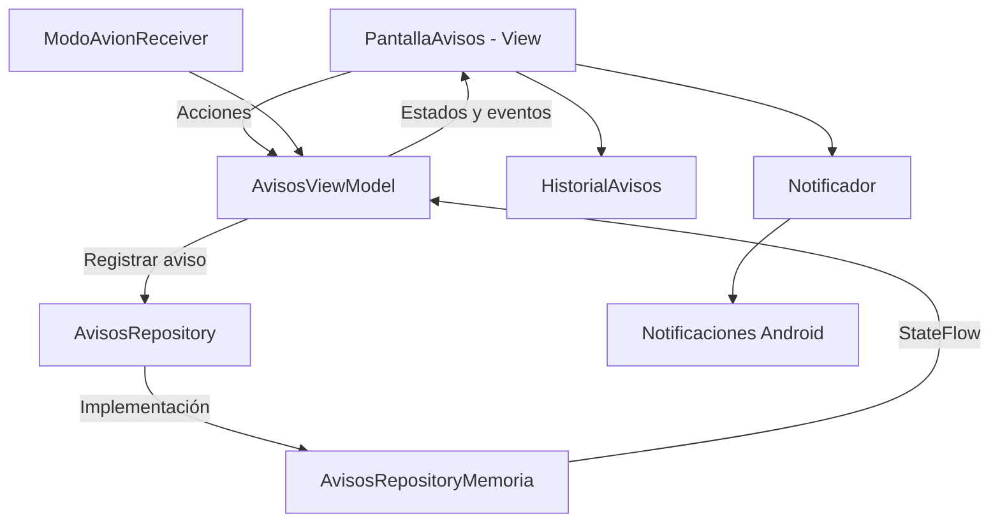
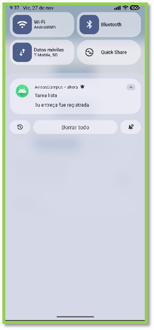
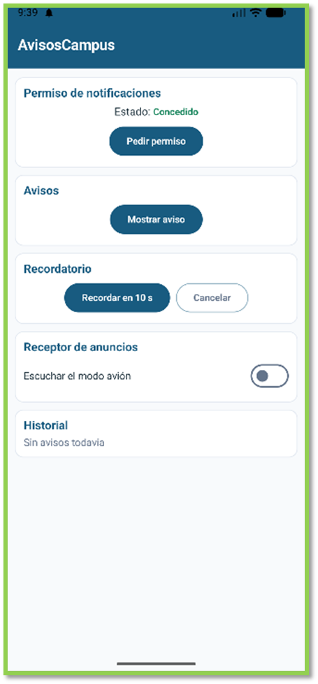
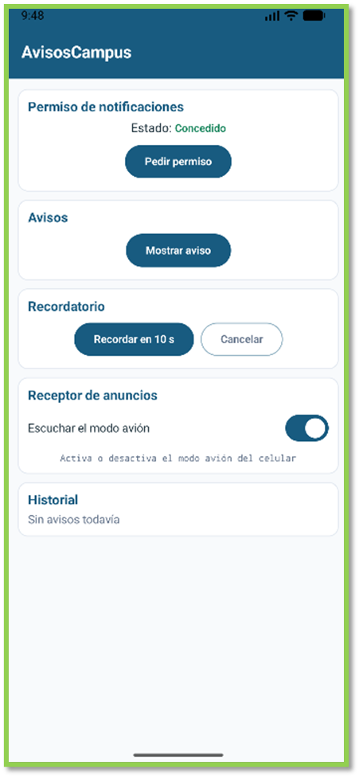
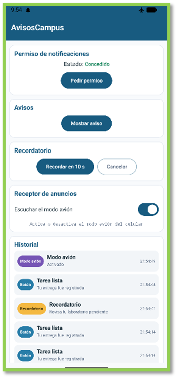
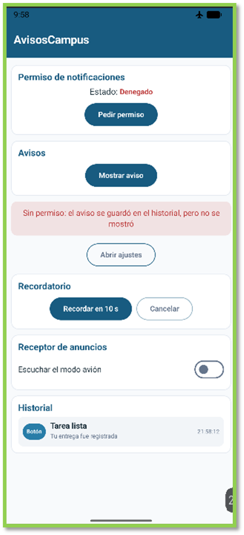

# AvisosCampus

## Laboratorio 15 - Programación en Móviles

**Estudiante:** Ramses Alvarez Contreras  
**Institución:** TECSUP  
**Rama:** main

## Descripción

AvisosCampus es una aplicación móvil desarrollada en Kotlin
con Jetpack Compose que permite generar notificaciones locales,
programar recordatorios y detectar cambios del modo avión.

La aplicación también cuenta con un historial de avisos y
maneja los casos en los que el usuario no concede el permiso
de notificaciones.

## Tecnologías utilizadas

- Kotlin
- Jetpack Compose
- Material 3
- Arquitectura MVVM
- Repository
- StateFlow y SharedFlow
- Corrutinas
- NotificationCompat
- PendingIntent
- BroadcastReceiver

## Funcionalidades

- Creación del canal de notificaciones Avisos.
- Solicitud del permiso de notificaciones.
- Envío de notificaciones locales mediante un botón.
- Apertura de la aplicación al tocar una notificación.
- Recordatorio de 10 segundos con opción de cancelar.
- Detección de cambios del modo avión.
- Historial de los últimos 20 avisos.
- Manejo del permiso denegado.
- Acceso a los ajustes de notificaciones.

## Estructura del proyecto

```text
com.alvarez.avisoscampus/
├── data/
│   └── AvisosRepository.kt
├── model/
│   └── Modelos.kt
├── notificacion/
│   └── Notificador.kt
├── receiver/
│   └── ModoAvionReceiver.kt
├── ui/
│   ├── theme/
│   │   ├── Color.kt
│   │   ├── Theme.kt
│   │   └── Type.kt
│   ├── HistorialAvisos.kt
│   └── PantallaAvisos.kt
├── viewmodel/
│   ├── AvisosViewModel.kt
│   └── AvisosViewModelFactory.kt
├── AvisosApp.kt
└── MainActivity.kt
```

## Arquitectura MVVM



La interfaz recibe las acciones del usuario y las comunica
al ViewModel. El ViewModel controla la lógica de la aplicación
y utiliza el repositorio para registrar los avisos.

El repositorio almacena los datos en memoria y mediante
StateFlow permite actualizar el historial automáticamente.

La clase Notificador se encarga de mostrar las notificaciones
utilizando las herramientas de Android.

## Capturas de funcionamiento

### 1. Notificación local

Al pulsar Mostrar aviso se genera una notificación con el
título Tarea lista.



### 2. Recordatorio

Se inicia una cuenta regresiva de 10 segundos que puede
cancelarse antes de finalizar.



### 3. Modo avión

Al activar el receptor se detectan los cambios del modo avión
y se generan las notificaciones correspondientes.



### 4. Historial de avisos

Se muestran los avisos registrados con su origen, título,
descripción y hora. Los más recientes aparecen primero.



### 5. Permiso denegado

Cuando no existe permiso, la aplicación muestra un mensaje
de error y conserva el aviso en el historial.



## Pruebas de aceptación

- [ ] El canal Avisos existe en los ajustes.
- [ ] Se solicita correctamente el permiso de notificaciones.
- [ ] El botón Mostrar aviso genera una notificación.
- [ ] Dos avisos generan notificaciones independientes.
- [ ] Al tocar la notificación se abre la aplicación.
- [ ] El recordatorio genera un aviso después de 10 segundos.
- [ ] El recordatorio funciona al minimizar la aplicación.
- [ ] Al cancelar el recordatorio no se genera un aviso.
- [ ] El receptor detecta la activación y desactivación del modo avión.
- [ ] Con el receptor desactivado no se generan avisos del modo avión.
- [ ] El permiso denegado muestra un error y conserva el historial.
- [ ] La cuenta regresiva continúa al rotar la pantalla.
- [ ] El ViewModel no utiliza Context y el receptor se libera en onDispose.

## Preguntas de reflexión

### 1. ¿Por qué una notificación necesita un canal y un permiso?

El canal permite organizar las notificaciones y configurar
su comportamiento. Desde Android 8 es necesario utilizarlo.
El permiso permite que el usuario autorice las notificaciones
desde Android 13. Si falta alguno de los requisitos aplicables,
la notificación no se muestra.

### 2. ¿Por qué el ViewModel emite un evento en lugar de mostrar la notificación?

Porque el ViewModel debe encargarse de la lógica y no depender
directamente de las herramientas de Android. La interfaz recibe
el evento y utiliza Notificador para mostrar el aviso.

### 3. ¿Qué pasa si se utiliza el mismo ID en dos notificaciones?

La segunda notificación reemplaza o actualiza la primera.
Por eso se utiliza un identificador diferente para cada aviso.

### 4. ¿Por qué onReceive debe ser corto y por qué se debe quitar el receptor?

Porque onReceive normalmente se ejecuta en el hilo principal
y una tarea larga puede bloquear la aplicación. El receptor
debe liberarse cuando ya no se utiliza para evitar registros
duplicados y problemas de memoria.

### 5. ¿Cuándo utilizar una notificación local y una push de Firebase?

Utilizaría una notificación local para recordatorios o eventos
que ocurren dentro del dispositivo. Usaría Firebase para enviar
avisos desde un servidor, como comunicados o mensajes nuevos.

## Ejecución del proyecto

1. Abrir AvisosCampusTec en Android Studio.
2. Sincronizar las dependencias de Gradle.
3. Iniciar un emulador con Android 13 o superior.
4. Ejecutar la aplicación.
5. Conceder el permiso de notificaciones.

## Limitaciones

El historial se almacena en memoria, por lo que no conserva
los datos después de finalizar el proceso de la aplicación.

El recordatorio utiliza corrutinas y depende del ciclo de vida
del ViewModel.

## Conclusiones

- Aprendí a implementar notificaciones locales y gestionar
  sus permisos dentro de una aplicación Android.

- Comprendí cómo utilizar corrutinas para ejecutar recordatorios
  sin bloquear la interfaz.

- La arquitectura MVVM me permitió separar la lógica,
  la interfaz y el almacenamiento de los avisos.
